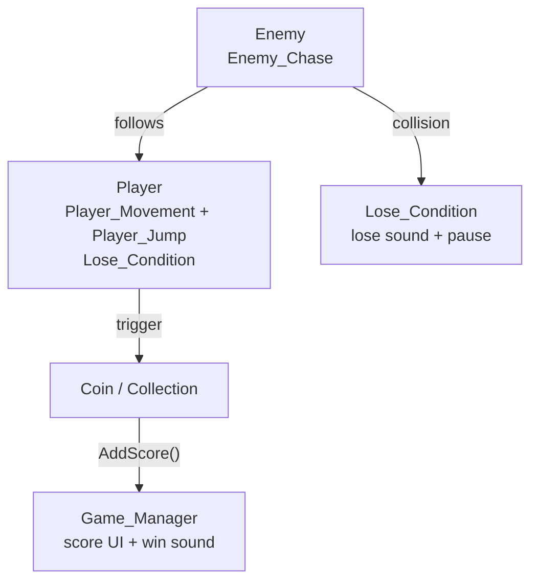

# Unity Coin Collector

A small **2D** Unity game. You move a player around a level to collect every coin while an enemy chases you. Collect them all to win; touch the enemy and you lose.

## Overview

A beginner Unity project that practises core 2D gameplay scripting: Rigidbody2D movement, trigger and collision events, tags, a simple game manager with a score UI, and audio feedback.

## Gameplay

| Element | Behaviour | Script |
|---|---|---|
| Player movement | Arrow keys / WASD (`Horizontal`/`Vertical` axes) move the player via `Rigidbody2D.MovePosition` | `Player_Movement.cs` |
| Jump | `Space` sets an upward velocity (`jump_force`) | `Player_Jump.cs` |
| Coins | On `OnTriggerEnter2D` with the `Player` tag: add score, destroy the coin | `Coin.cs`, `Collection.cs` |
| Score & win | Counts objects tagged `Coin` at start. Updates a UI `Text` ("Score: N"). When all are collected, plays the win sound, logs "You Win!" and pauses (`Time.timeScale = 0`) | `Game_Manager.cs` |
| Enemy | Moves toward the player every frame with `Vector2.MoveTowards` | `Enemy_Chase.cs` |
| Lose | On collision with an object tagged `Enemy`: plays the lose sound, logs "Game Over", pauses | `Lose_Condition.cs` |

## Technologies

- **Unity 2022.3.62f3 (LTS)**, from `ProjectSettings/ProjectVersion.txt`
- C# (MonoBehaviour scripts)
- Packages: `com.unity.feature.2d` 2.0.1, `com.unity.ugui` 1.0.0, `com.unity.textmeshpro` 3.0.7, `com.unity.timeline` 1.7.7, among others (see `Packages/manifest.json`)

## Architecture



## Project Structure

```
.
├── Assets/
│   ├── Scenes/
│   │   ├── Collect Coins.unity   # main game scene
│   │   └── SampleScene.unity     # default template scene
│   ├── Coin.cs  Collection.cs  Enemy_Chase.cs  Game_Manager.cs
│   ├── Lose_Condition.cs  Player_Jump.cs  Player_Movement.cs  Win_Condition.cs
│   ├── mixkit-video-game-win-2016.wav
│   └── mixkit-retro-arcade-lose-2027.wav
├── Packages/             # manifest.json, packages-lock.json
├── ProjectSettings/
└── .gitignore            # excludes Library/, Logs/, UserSettings/, IDE files
```

## Installation and Usage

1. Install **Unity Hub** and **Unity 2022.3.62f3** (any 2022.3 LTS should work).
2. Clone the repo and choose **Add project from disk** in Unity Hub, selecting this folder. Unity regenerates `Library/` on first open, which takes a few minutes.
3. Open `Assets/Scenes/Collect Coins.unity` and press **Play**.

Controls: **Arrow keys / WASD** to move, **Space** to jump.

## Configuration

None. Gameplay values (`speed`, `jump_force`, enemy `speed`) are public fields you can edit in the Inspector.

## Known Issues

- ⚠️ **`Assets/Win_Condition.cs` does not compile.** It increments a method name (`AddScore++`), references an undefined `scoreText`/`score`, has an `if` block outside any method, and is missing a semicolon. Unity will report compiler errors and block Play mode until the file is fixed or removed. The win logic is already implemented in `Game_Manager.cs`, so this script appears to be an unused draft. It has been left unchanged in this repository.
- `Coin.cs` and `Collection.cs` implement the same behaviour. The main scene uses `Collection.cs` (7 references). Neither `Coin.cs` nor `Win_Condition.cs` is attached to any object in `Collect Coins.unity`.
- Win and lose outcomes are shown only through `Debug.Log` and pausing. There is no end screen or restart.

## Assets and Credits

The two sound effects come from [Mixkit](https://mixkit.co/) (file names `mixkit-…`). Check Mixkit's licence terms before redistributing them.

## Future Improvements

- Fix or remove `Win_Condition.cs` and merge `Coin`/`Collection`.
- Add win/lose UI panels with a restart button, plus multiple levels.
- Build a WebGL version that can be played in a browser.

## Author

**Mosap Abdel-Ghany**: [github.com/Mosapmohamd](https://github.com/Mosapmohamd)
